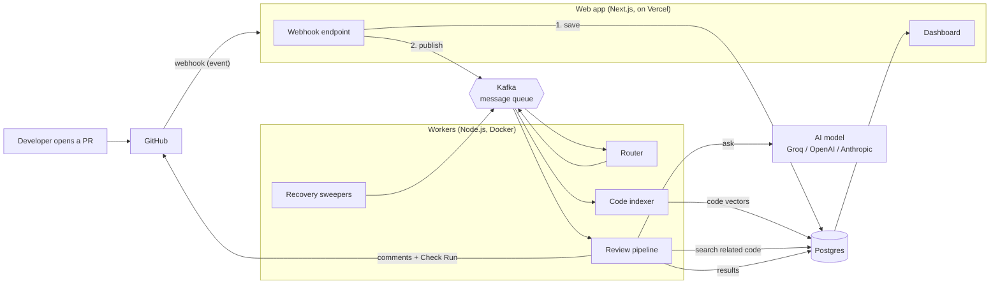
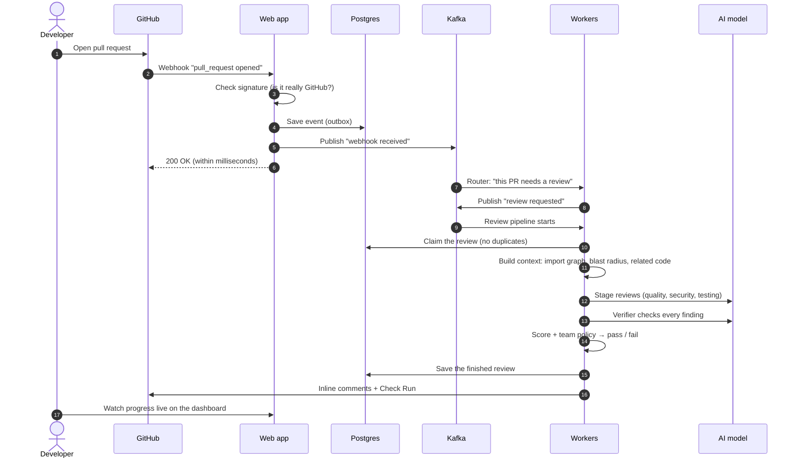
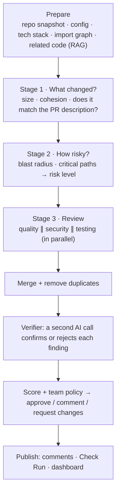

# CodeGuard AI: High-Level Design

> **Read this first.** It explains *what* CodeGuard is, *why* it exists, and *how* the pieces fit together, in plain words. You don't need to know Kafka or AI to follow it. Each part links to a short page with the details.

---

## 1. The problem

When a developer opens a **pull request (PR)** on GitHub, a teammate has to review it. Human review is slow, people get tired, and it's easy to miss things like:

- a security hole (for example, accepting unsigned login tokens),
- a change to one small file that quietly breaks ten other files that use it,
- new code with no tests.

Simple "AI review" tools send the diff to a chatbot and post whatever comes back. That gives two new problems:

1. **The AI only sees the diff.** It doesn't know which other files depend on the change, so it misses the real risk.
2. **The AI is often wrong.** After a few wrong comments, developers stop reading the bot.

## 2. What CodeGuard does

CodeGuard is a **GitHub App** that reviews every pull request automatically, the way a careful senior engineer would:

1. **Understand the change:** what changed, and does it match what the PR says it does?
2. **Measure the risk:** which other files depend on the changed code? Does it touch critical areas like auth or billing?
3. **Review it:** three focused AI reviewers (quality, security, testing) look at the change, with related code from the repo as context.
4. **Double-check:** a second AI call checks every finding and throws out the wrong ones.
5. **Decide and report:** the team's own rules decide pass or fail. CodeGuard posts inline comments on the PR plus a **Check Run** that can block the merge.

> **One sentence:** CodeGuard is an AI code reviewer for GitHub pull requests that works out *how far* a change reaches before it judges it, and checks its own findings before posting them.

## 3. The big picture

### The five building blocks

| Block | What it is | Its one job |
|---|---|---|
| **GitHub App** | CodeGuard's identity on GitHub | Receive PR events, read code, post comments and checks |
| **Web app** (`apps/web`) | Next.js website + small API | Accept webhooks fast, show the dashboard |
| **Kafka** | A message queue | Carry jobs from the web app to the workers, safely and in order |
| **Workers** (`apps/workers`) | Background Node.js processes | Do the slow work: index code, run the AI review, recover stuck jobs |
| **Postgres** (with **pgvector**) | The database | Store everything: events, reviews, findings, and code "vectors" for search |

### Shared packages (the monorepo)

| Package | Job |
|---|---|
| `packages/review-engine` | All AI logic: prompts, model providers, reviewers, verifier, scoring, GitHub output |
| `packages/kafka` | Topic names, event shapes (validated with Zod), producer, dead-letter helper |
| `packages/db` | Database tables (Drizzle) and migrations |
| `packages/config` | Environment variables, checked once at startup |
| `packages/types` | Small shared types (severity, review issue) |

Web and workers share these packages. If an event's shape changes, TypeScript breaks **both** sides at build time, not in production.

## 4. How one pull request flows through the system

Each numbered step has its own page:

| # | Step | Page |
|---|---|---|
| 1 | Connect a repo (install the GitHub App) | [steps/01-connect-repo.md](steps/01-connect-repo.md) |
| 2 | Receive the webhook | [steps/02-receive-webhook.md](steps/02-receive-webhook.md) |
| 3 | Kafka, the message highway | [steps/03-kafka.md](steps/03-kafka.md) |
| 4 | Route the event | [steps/04-route-event.md](steps/04-route-event.md) |
| 5 | Index the code for search | [steps/05-index-code.md](steps/05-index-code.md) |
| 6 | Claim the review (no duplicates) | [steps/06-claim-review.md](steps/06-claim-review.md) |
| 7 | Prepare the context | [steps/07-prepare-context.md](steps/07-prepare-context.md) |
| 8 | The staged AI review | [steps/08-staged-review.md](steps/08-staged-review.md) |
| 9 | Merge and verify findings | [steps/09-verify-findings.md](steps/09-verify-findings.md) |
| 10 | Score, policy and the decision | [steps/10-decide.md](steps/10-decide.md) |
| 11 | Publish to GitHub | [steps/11-publish.md](steps/11-publish.md) |
| 12 | Dashboard and live progress | [steps/12-dashboard.md](steps/12-dashboard.md) |
| 13 | Failure and recovery | [steps/13-recovery.md](steps/13-recovery.md) |

## 5. The key design ideas

These six ideas explain almost every decision in the code.

1. **Answer fast, work later.** GitHub wants a webhook answered within 10 seconds; an AI review takes minutes. So the web app only *saves and hands off* the job. Workers do the slow part.
2. **Save first, then send (outbox).** The event is written to Postgres *before* it goes to Kafka. If Kafka is down, nothing is lost; a sweeper sends it later.
3. **Duplicates are fine, losses are not.** Messages can arrive twice, so every worker is *idempotent*: doing the same job twice has the same effect as doing it once.
4. **Context beats a bigger model.** The review quality comes mostly from *what the AI sees*: the blast radius, related code, and the callers of changed functions.
5. **Don't trust the AI blindly.** Every AI answer is validated against a schema, every finding is checked by a second AI call, and PR text is fenced off so it can't give the AI orders.
6. **Code decides the gate, not the AI.** The AI gives opinions. Pass or fail comes from rules the team writes in `.codeguard.yml`, so the result is predictable and explainable.

## 6. The AI part, in one picture

The AI concepts behind this are explained one per page in [ai/](ai/README.md): LLM basics, prompts and prompt injection, structured output, embeddings and RAG, context engineering, blast radius, the verifier, evals, and why this is a pipeline and not an agent.

## 7. Tech stack at a glance

| Layer | Choice | Why |
|---|---|---|
| Web + API | Next.js 16, React 19, Tailwind | One codebase for UI and API routes; easy to host on Vercel |
| Login | Clerk (GitHub sign-in) | Who the user is on the website |
| GitHub access | GitHub App | Narrow permissions, short-lived tokens |
| Queue | Apache Kafka (kafkajs) | Ordered, buffered, replayable job delivery |
| Database | Postgres (Neon) + Drizzle ORM | One database for everything |
| Vector search | pgvector | Code search lives next to the rest of the data |
| Code parsing | Tree-sitter | Real syntax trees for imports and code chunks |
| AI models | Groq, OpenAI or Anthropic (one env var) | Swap models without touching pipeline code |
| Validation | Zod | Env, events and AI output are all checked at the boundary |
| Tests | Vitest + an AI eval harness | Unit tests for logic, evals for review quality |

## 8. Where to go next

- **New to the project?** Read sections 1 to 5 above, then the 13 step pages in order.
- **Interested in the AI?** Go to [ai/README.md](ai/README.md).
- **Want to run it?** See [Run it locally](../README.md#-run-it-locally) in the main README.
- **Want to measure review quality?** See [apps/workers/evals](../apps/workers/evals/README.md).
