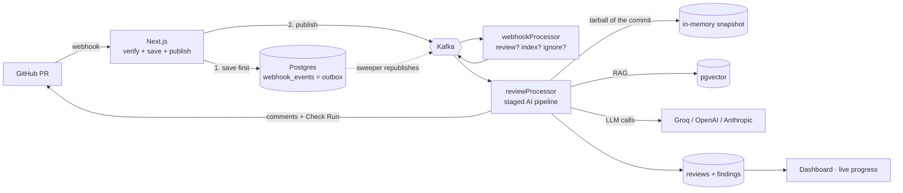
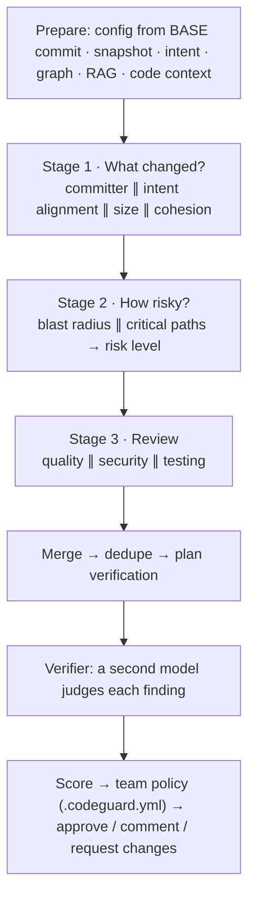
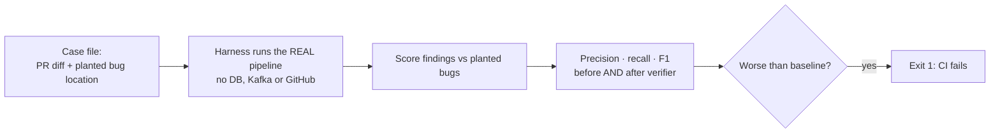
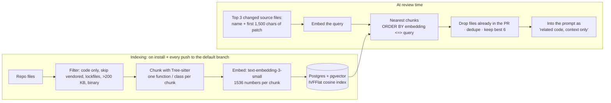

# CodeGuard AI: Interview Guide in 5 Parts

| Part | Question it answers |
|---|---|
| [1. How it works](#part-1-how-it-works) | "Walk me through the project." |
| [2. How the AI review works and how accurate it is](#part-2-how-the-ai-review-works-and-how-accurate-it-is) | "How does the AI part work? How do you know it's right?" |
| [3. Context engineering](#part-3-context-engineering) | "What do you give the model, and how did you build that?" |
| [4. RAG: purpose and why](#part-4-rag-purpose-and-why) | "Why RAG? How does it work here?" |
| [5. Other interview questions](#part-5-other-interview-questions) | Everything else: scale, reliability, security, behaviour |

Every part has the same shape: **simple explanation → diagram or table → 🎤 how to say it → follow-up questions.**
Numbers here match the code. Measured results are marked as measured, and their limits are stated. More depth on every step (HLD, LLD, edge cases): [INTERVIEW-PREP.md](INTERVIEW-PREP.md).

---

## Part 1: How it works

### In one line
A pull request opens → GitHub sends a webhook → my app saves it and puts it on Kafka → workers run a staged AI review → inline comments and a pass/fail Check Run appear on the PR.

### The big picture

### Step by step

| # | What happens | Why it's built this way |
|---|---|---|
| 1 | GitHub sends a webhook | It's an event: a push to us, not polling |
| 2 | Check the **HMAC signature** on the raw body with `timingSafeEqual` | Proves it came from GitHub; prevents timing attacks |
| 3 | **De-duplicate** by `X-GitHub-Delivery` (UNIQUE column) | GitHub can deliver twice |
| 4 | **Save to Postgres first** (outbox), then publish to Kafka, then reply 200 | GitHub waits about 10 s and a review takes minutes. If Kafka is down, the row is safe and a sweeper publishes it later. |
| 5 | `webhookProcessor` decides: review, index or ignore | One small, testable routing function |
| 6 | `reviewProcessor` **claims** the review (unique index on PR + commit + requester) | Kafka can redeliver; a duplicate must do no work |
| 7 | **Download a read-only snapshot** of the exact commit (in memory, never executed) | Exact code for the graph, definitions and call sites |
| 8 | **Build context**: config, intent, blast radius, RAG, definitions, call sites | Context quality decides review quality (Part 3) |
| 9 | **Staged AI review** → dedupe → **verifier** → policy decision | Accuracy and control (Part 2) |
| 10 | Save to DB **first**, then post comments and the Check Run | A GitHub failure doesn't lose the AI work or double-post |

### What makes it reliable

| Problem | Protection |
|---|---|
| Kafka down | Outbox row + sweeper (every 60 s; resends after 10 min stuck; gives up after 5 attempts) |
| Duplicate webhook or message | UNIQUE delivery ID + idempotent claim per (PR, commit, requester) |
| Worker crashes mid-review | A heartbeat on every pipeline step; after 15 min of silence the recovery sweeper re-queues it, up to 3 times |
| Poison message | 3 attempts with backoff (2 s, 4 s), then the dead-letter topic; the partition never blocks |
| Slow LLM call | Kafka heartbeat every 3 s, so no rebalance |
| Events of one PR out of order | Message key `owner/repo#number` → same partition → in order |
| LLM provider down | Optional steps are skipped; deterministic checks still run |

> 🎤 **Say it like this (2 minutes)**
>
> "CodeGuard reviews GitHub pull requests. When a PR opens, GitHub sends a webhook to my Next.js app. The handler only verifies the HMAC signature, saves the event to Postgres, publishes it to Kafka and returns, because GitHub waits about ten seconds and a review takes minutes.
>
> Saving before publishing is the transactional outbox pattern: if Kafka is down, the row is still there and a sweeper publishes it later. That means a message can arrive twice, so every consumer is idempotent. The review worker first claims the review in the database with a unique index on PR, commit and requester, so a duplicate does nothing.
>
> Then the worker downloads a read-only snapshot of the exact commit and builds context: the team's config, what the PR is meant to do, which files depend on the change, related code from vector search, and the definitions and call sites of what changed. Three AI reviewers run in parallel (quality, security, testing), a second model verifies every finding, and team policy decides pass or fail. It saves the result first, then posts inline comments and a Check Run that can block the merge."

### Follow-up questions
- **Why Kafka and not a direct call?** The webhook must return fast; the review is slow. A queue decouples them, absorbs spikes and survives crashes. At this size SQS or a Postgres queue would also work. I chose Kafka for per-PR ordering and replay, and to learn it properly.
- **At-least-once or exactly-once?** At-least-once with idempotent consumers. Exactly-once can't span Kafka *and* Postgres *and* GitHub.
- **Why save before posting to GitHub?** If GitHub fails, the expensive AI work isn't lost, and a retry won't post twice.

---

## Part 2: How the AI review works and how accurate it is

### 2.1 The review pipeline

**Rules that make it robust:**
- **Required vs optional steps.** A required step failing fails the run (Kafka retries it). An optional one is skipped with a note, so one flaky call doesn't sink the review.
- **Deterministic checks run alongside the AI.** A secret scanner and risky-pattern rules always run. A regex can't be talked out of finding a leaked key.
- **Model output is untrusted input.** Every answer must be JSON that matches a Zod schema. If not, the model gets its own answer plus the exact error and one chance to repair it. Still wrong means rejected. Bad data never reaches the database.
- **Prompt-injection defence.** Everything from the PR author goes inside a random tag like `<untrusted-3f9a…>`, and the system prompt says it's data, never instructions. Config is read from the **base** commit, so a PR can't weaken its own rules. The model has no tools and can't approve anything.
- **The gate is code, not the model.** Pass or fail comes from team policy: fail on critical findings, block secrets, require tests. That makes it predictable and explainable.

### 2.2 The model calls in one review

| Call | Job |
|---|---|
| Intent | Why does this PR exist? (title, description, commits, linked issues) |
| Alignment | Does the diff do what the PR says? (scope only, not bugs) |
| Quality reviewer | Bugs, logic, performance, maintainability |
| Security reviewer | Exploitable vulnerabilities with an attack path |
| Testing reviewer | Is the changed behaviour tested? (only if tests changed) |
| Verifier | Confirm, downgrade or reject each finding (up to 25) |

### 2.3 Cutting false positives (why the verifier exists)
A bot that's wrong a few times gets ignored, so **precision matters more than recall** for a review bot.

1. **Path check:** a finding must point at a file in the diff, or it becomes a PR-level comment.
2. **Dedupe:** same file, within 3 lines, similar words → merged. Agreement between two reviewers *raises* confidence. A no-line finding is merged into a line-level one about the same bug.
3. **Verifier:** confirmed → kept; uncertain (or no verdict) → kept one severity lower; rejected → removed. Only confirmed findings can block a merge on their own. If the verifier itself fails, findings are kept as "unverified": never lose the whole review.

### 2.4 How I check the review is accurate: the eval harness
**Problem:** without measurement, "I improved the prompt" is a feeling.
**Solution:** a test suite for review quality ([apps/workers/evals](../apps/workers/evals/README.md)).

- **Cases (13):** SQL injection, XSS, JWT `alg: none`, path traversal, admin check with `=` instead of `===`, missing `await`, async `forEach`, off-by-one, N+1 queries, two **clean PRs** to catch false alarms, and two **code-context** cases that can only be solved with the repo's other files.
- **Scoring:**

| Result | Rule |
|---|---|
| True positive | Right file, line inside the bug's range ± 3 |
| Duplicate | Another report of an already-found bug (noise, not a wrong claim) |
| False positive | Anything else with a file; every finding on a clean PR |
| Blocking false positive | A false positive at high/critical severity: could wrongly fail a merge |

- **Metrics:**
  - **Precision** = of what we reported, how much was real.
  - **Recall** = of the real bugs, how many we found.
  - **F1** = the balance of the two.
  - Also: false positives per PR, blocking false positives, and the share of clean PRs with zero false alarms.
- **Every run is scored twice**, before and after the verifier, so the verifier's value is a number.
- **Honest data:** if any model call fails (for example a rate limit), the case is marked **DEGRADED** and left out of the totals, and the run can't become the baseline. The first version didn't do this, and a rate limit looked like a missed bug.

### 2.5 What the eval measured (model: `openai/gpt-oss-120b` on Groq)

| Run | Cases scored | Precision before → after verifier | Recall | Notes |
|---|---|---|---|---|
| 1st (rate-limited) | 11, 2 damaged | 50% → 57% | 89% | 5 of 6 false positives came from the **alignment step** repeating real bugs as file-level comments |
| After fixing alignment + dedupe | 9 of 11 clean | **47% → 80%** | **100%** | False positives per PR 0.55 → 0.22; 0 blocking; clean PR passed |
| Code-context cases | 2 of 2 | 67% → 67% | **100%** | The reviewer quoted facts that only the new context shows (the caller's file, "formatMoney expects dollars") |

> 🎤 **"How accurate is your AI review?" Say it like this**
>
> "I measure it instead of guessing. I built an eval harness: PRs with planted bugs, run through the real pipeline, scored on precision (how much of what I report is real) and recall (how many real bugs I find), before and after the verifier.
>
> On my last clean run, 9 cases with an open-source 120B model on Groq, recall was 100%, and the verifier raised precision from 47% to 80%, with zero false positives at blocking severity.
>
> The eval also found a real problem: my first run showed most false positives came from one step, the intent checker, repeating real bugs as vague file-level comments. I fixed it and re-measured.
>
> To be honest about limits: it's a small, hand-written set, so it shows direction, not a production accuracy figure. The next step is cases from real bug-fix commits, where the commit before the fix contains the bug, plus online signals like how often developers dismiss a comment."

### 2.6 Known limits and next steps
- **Small set** (13 cases, written by me) → add cases mined from real bug-fix commits.
- **One model** → run the same eval across providers (`LLM_PROVIDER=anthropic pnpm eval`).
- **The alignment step is still the top source of false positives** → move its findings to PR level (summary only).
- **The verifier reads but can't look things up** → evidence-based verification checks over the snapshot (Part 3.6).
- **No production signal yet** → track the dismiss rate per rule and learn from dismissals.

---

## Part 3: Context engineering

### 3.1 What it is
**Context engineering = choosing exactly what the model sees for each call.** Models have a limited window, every token costs money and time, and models miss details in very long inputs. So the job is to send *less text, but the right text*. Quality depends more on context than on the model; CodeRabbit's blog makes the same point.

### 3.2 The context layers

| Layer | What the model gets | Where it comes from | Why |
|---|---|---|---|
| **Diff** | Changed files with new-file line numbers, **whole files only** | GitHub PR API | Line numbers for inline comments; never half a function |
| **Ranking** | Riskiest files first within each budget | Blast radius + each reviewer's priorities | Limited budget goes to code most likely to break |
| **Intent** | One-paragraph summary of *why* the PR exists | Intent model call | Judge the change against its purpose |
| **Team rules** | `instructions` from `.codeguard.yml` | **Base** commit | Team conventions; a PR can't change its own rules |
| **Stack checklist** | e.g. React or Kafka-consumer checks | Detected tech (file tree, manifests) | Stack-specific mistakes |
| **Blast radius notes** | Files that depend on the change, and the risk level | Import graph + BFS (depth 3) | Know how far a change reaches |
| **RAG related code** | Up to 6 similar chunks from the repo | pgvector search (Part 4) | Code that *looks like* this change |
| **Definitions** | Declarations + doc comments of what the added lines use | Code-context step, from files the change imports | Know what a function *expects* |
| **Call sites** | Lines that call changed functions, ±2 lines, marked "NOT changed by this PR" | Code-context step, from files that import the change | Know *how* changed code is used |
| **Breaking changes** | "`chargeCard` now needs 3 args, `checkout.js:6` passes 2" | Signature diff + call sites | Catch broken callers deterministically |
| **Already reported** | Scanner findings | Deterministic rules | The model doesn't repeat them |

**Never sent:** lockfiles, build output, minified files, source maps, snapshots, and the repo's `ignore` globs.

### 3.3 Each model call gets its own pack and budget

| Call | Budget (chars) | Goes first |
|---|---|---|
| Alignment | 16,000 | source files |
| Quality | 28,000 | biggest source files + graph hotspots; RAG + symbol usages + code context |
| Security | 24,000 | auth/routes/sql/upload files and scanner-flagged files; RAG + code context |
| Testing | 16,000 | test files, then the code they cover |
| Verifier | 28,000 | only files that have findings; RAG + code context |

### 3.4 How the prompt is laid out
- **System message** (ours, trusted): role and focus, how to read the diff, the injection guard, the exact JSON shape, "an empty list is a valid answer".
- **User message** (data): checklist → team rules → intent → notes (dependents, changed functions, risk) → already-reported → **inside the random untrusted tag:** PR title, related code (marked "context only"), the diff.

### 3.5 How I built it: the story (tell it in this order)

| Version | What I did | Problem it solved |
|---|---|---|
| v1 | `diff.slice(0, 12000)` | Simple, but it cut functions in half and wasted budget on unimportant files |
| v2 | **Import graph + BFS blast radius**, rank files, include whole patches | A one-line change to a shared utility now outranks 200 lines in an isolated test |
| v3 | **Per-reviewer context packs** with their own budgets and priorities | The security reviewer sees auth code first; the testing reviewer sees tests first |
| v4 | **RAG** over an AST-chunked index | The model sees related code beyond the diff |
| v5 | **Code context** (after reading CodeRabbit's post): definitions, call sites, breaking changes | The model was told *which* files depend on a change, but never *how* they use it |
| v6 | **Read-only snapshot** of the exact commit (tarball → memory, never executed) | The graph used default-branch index chunks with caps; now it's the exact commit |

**Evidence it works (measured):** in the code-context eval cases, the reviewer's comments cite *"formatMoney expects a dollar amount"* and *"existing call sites (e.g., checkout.js)"*. Neither fact is in the diff; both came only from the new context. **Still to do:** an A/B run with code context switched off, to put a number on it.

> 🎤 **Say it like this**
>
> "I treat context as the main lever, not the model. Each model call gets its own context pack with its own budget, ordered by what that reviewer cares about. Inside a budget I include whole files, never half a hunk, and I tell the model what I left out.
>
> On top of the diff, I add four kinds of context. **Why**: the PR's intent and the team's rules from the base branch. **How far**: the blast radius from an import graph. **What's similar**: RAG over the repo. **What's connected**: the definitions the new code relies on and the call sites of functions it changes. The last one came from reading CodeRabbit's context-engineering post. I realised my model was told *which* files depend on a change but never *how* they use it. Now it sees the caller's actual line, and if a signature change breaks a caller outside the PR, that's flagged deterministically.
>
> All of it is built from a read-only snapshot of the exact commit, downloaded as a tarball into memory and never executed. My eval shows the reviewer quoting facts only this context provides. The next step is an A/B run to put a number on it."

### 3.6 What's next in context engineering
- **Evidence-based verifier.** It may request read-only checks (`find_calls`, `find_definition`, `search`, `read_lines`) on the snapshot, and a finding is confirmed only with cited evidence. This is CodeRabbit's "verification scripts" idea without running generated code.
- **Team rules from existing files:** `CLAUDE.md`, `AGENTS.md`, `.cursorrules`, Copilot instructions.
- **Path-specific instructions** (`src/api/**` → "validate input with Zod").
- **Related past PRs** touching the same files (the *why* behind existing code).
- **Measure the context-to-code ratio** and let RAG grow with diff size.

---

## Part 4: RAG: purpose and why

### 4.1 What RAG is
**Retrieval-Augmented Generation:** before asking the model, **search your own data for the relevant pieces and put them in the prompt.** The model "reads before it answers".

### 4.2 Why CodeGuard needs it

| Problem | How RAG helps |
|---|---|
| The repo is far too big to send | Send only the few chunks that matter |
| The model was never trained on *your* code | It reads your actual code at review time |
| The code changes every day | The index updates on every push; nothing to retrain |
| Generic advice ("consider validating input") | Specific advice ("`verifyJWT.ts` already validates this") |
| Hallucinated assumptions about other files | Grounds the review in real code |

### 4.3 How it works here

**Key decisions:**
- **AST chunks, not fixed-size chunks.** A fixed 500-character chunk can cut a function in half, and half a function is a bad search result. A whole function is meaningful on its own.
- **One query per important file.** One big file shouldn't dominate a single combined query.
- **pgvector instead of a separate vector database.** One system, joins and filtering by repository, transactions, cheap at this size. A dedicated vector DB makes sense at tens of millions of vectors.
- **Incremental.** A push re-indexes only the changed files: delete old chunks, insert new ones.
- **Optional.** If embeddings are down, the review still runs with less context.

### 4.4 RAG vs the other context sources (a strong answer)

| Source | Finds | Example |
|---|---|---|
| **RAG (vectors)** | Code that is **similar** in meaning | Another handler that validates tokens the same way |
| **Import graph** | Code that is **connected** | Every file that imports `token.ts` |
| **Code context** | The **exact lines** that define or call changed code | `checkout.js:6 chargeCard(id, total)` |
| **Snapshot** | The **exact commit**, not the default branch | Code added in this PR's own branch |

> "RAG finds what's *similar*, the graph finds what's *connected*. A review needs both. Similarity alone misses the caller that will break; structure alone misses the similar code that shows the team's pattern."

### 4.5 RAG vs fine-tuning vs long context

| Option | Good for | Why not the main tool here |
|---|---|---|
| **RAG** ✅ | Knowledge that changes (your code changes daily) | Chosen |
| Fine-tuning | Style, format, behaviour | Would go stale every commit; expensive; doesn't teach facts reliably |
| Very long context | Small repos | Cost and latency grow with tokens; models miss details in long inputs |

### 4.6 Limits and improvements

| Limit today | Improvement |
|---|---|
| Vector search only; exact names like `verifyJWT` can be missed | **Hybrid search**: vectors + keyword (BM25 / Postgres full-text), merged with reciprocal rank fusion |
| Top-6 by raw similarity | **Reranker** over ~30 candidates |
| IVFFlat index (recall drops as data changes) | **HNSW** index |
| General-purpose embedding model | Code-specific embeddings |
| The index follows the default branch | The snapshot now covers the exact commit for graph and code context |
| Not used in the eval (needs a real repo) | Eval cases built from a real indexed repo |
| Code with secrets could be embedded | Run the secret scanner before embedding, and redact |

> 🎤 **Say it like this**
>
> "RAG means retrieving relevant data before the model answers. A whole repo doesn't fit in a prompt, and the model was never trained on my users' code, which changes every day. So I index the repo: Tree-sitter splits it into whole functions and classes, each is embedded into 1,536 numbers and stored in Postgres with pgvector. At review time I embed the changed code, fetch the nearest chunks by cosine distance, drop files already in the PR, and add the best six as 'related code'.
>
> RAG finds what's similar; my import graph finds what's connected. So I use both, plus the exact definitions and call sites from a snapshot of the commit. To improve RAG I'd add hybrid keyword search, because code questions often hinge on exact names, then a reranker and an HNSW index."

---

## Part 5: Other interview questions

### System design and scale
- **"Scale to 10,000 PRs a day?"** That's about 7 a minute, so Kafka and Postgres aren't the bottleneck; the LLM's rate limits and cost are. Add worker replicas in the consumer group, raise partitions, let each worker consume several partitions at once, share one token-bucket rate limiter in Redis, and give users waiting on the dashboard a priority lane.
- **"Cut the cost in half?"** Skip outdated commits, debounce rapid pushes, review only new commits (already done), route easy steps to a cheaper model, cache the shared prompt prefix, and skip docs-only PRs.
- **"Pipeline or agent?"** A pipeline, on purpose: predictable cost and latency, and every step testable. I'd add agency only where it pays, as a bounded, read-only, evidence-checking verifier.
- **"Why Groq / which model?"** Fast and cheap open model (`gpt-oss-120b`). The provider is one interface (Groq, OpenAI, Anthropic by env var), and my eval lets me compare them on numbers.

### Reliability
- **"Kafka is down?"** The webhook is saved first; GitHub gets a 200; the outbox sweeper publishes it later.
- **"Same webhook twice?"** The unique delivery ID drops it; the per-commit claim makes any duplicate that gets through a no-op.
- **"Worker crashes mid-review?"** The heartbeat stops; after 15 minutes the recovery sweeper re-queues it (max 3 times, then failed with a clear message).
- **"Rate limits from the LLM?"** Retries with backoff, jitter and `Retry-After`; optional steps degrade instead of failing. My eval found the free tier still drops calls, so the next fix is waiting out the provider's "try again in N s" hint.
- **"What's in the dead-letter queue?"** Messages that can't be parsed or failed 3 times. It doesn't block the partition. Missing: alerts and a replay tool.

### Security
- **"Prompt injection from a PR?"** Random untrusted tag, system rules, config from the base branch, no tools, and a deterministic gate. An injection can at most change a comment, not pass/fail.
- **"Webhook security?"** HMAC-SHA256 on the raw body, constant-time compare, fails closed without a secret, dedupe stops replays.
- **"Running untrusted code?"** I never do. The snapshot is read into memory as text. Running linters would need an isolated container with no network and no secrets.
- **"Customer code privacy?"** Code goes to the model provider. Use no-training terms, or swap in a self-hosted model (one interface).

### AI and LLM
- **"How do you stop hallucinations?"** Grounding (real context), file and line checks against the diff, Zod schemas, a verifier, deterministic scanners, a policy gate, and an eval to measure it.
- **"Why a second model as verifier?"** The finder is told to be thorough, so it over-reports. An independent check cut false positives per PR from 0.55 to 0.22 on my eval.
- **"Temperature?"** 0.2: consistent output for a reviewer.
- **"Structured output?"** JSON mode + Zod + one repair turn. Next: provider-enforced JSON schema or tool calling.

### Testing and quality
- **"How is it tested?"** 271 unit tests. The logic is pure functions with I/O injected (routing, dedupe, verifier verdicts, graph, tar reader, code context). The AI quality is tested by the eval harness. CI runs typecheck, lint, tests, a migration check, an audit and a secret scan, plus a review-eval job.

### About you (behavioural)
- **"Hardest bug?"** A failed installation sync could never be retried, because GitHub's redelivery reused the same delivery ID and my dedupe dropped it. I made failed deliveries re-runnable (`ON CONFLICT … WHERE status = 'failed'`) and tested it. Lesson: "seen before" isn't "done".
- **"Something your data proved wrong?"** My eval showed most false positives came from one step, the intent checker, not from the reviewers. I'd have guessed the opposite.
- **"Weaknesses?"** Single Kafka broker, a small eval set, an alignment step that still over-reports, a verifier that reads but can't look things up, no alerting on the dead-letter queue.
- **"How is it different from CodeRabbit?"** Theirs is agent-first: it clones into a sandbox, runs 40+ linters, and runs verification scripts. Mine is retrieval-first: a read-only snapshot, a graph-ranked context, a verifier, and a deterministic merge gate, and it never runs code. They're ahead on tool-based verification, linters and learning from feedback; those are my next steps.
- **"Two more weeks?"** The evidence-based verifier, more eval cases from real bug-fix commits with an A/B on code context, and learning from dismissed findings.

---

**Golden rule for any answer:** *answer first → why → the trade-off → what I'd do next.* Saying a limit out loud with a fix ready beats pretending it's perfect.
