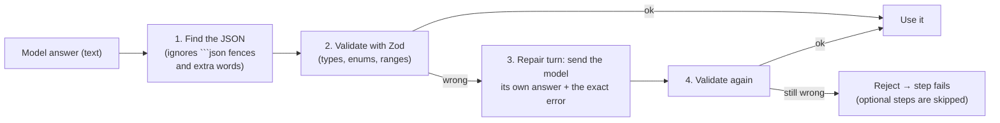

# AI 3: Structured output

⬅ [Prompts and injection](02-prompts-and-injection.md) · Next ➡ [Embeddings and RAG](04-embeddings-and-rag.md)

> **In plain words:** we need the model's answer as *data* (a list of findings with file, line and severity), not as a friendly paragraph. So we ask for JSON, and then we check it as carefully as we would check user input.

---

## 1. How it begins

Every model call in the pipeline goes through `s.llm.json(messages, Schema)` ([structured.ts](../../packages/review-engine/src/structured.ts)). For example, a reviewer must return:

```json
{
  "summary": "Adds unsigned-token support to JWT verification.",
  "issues": [
    {
      "severity": "critical",
      "category": "security",
      "file": "auth/token.ts",
      "line": 3,
      "message": "Default algorithm 'none' lets anyone forge a token.",
      "suggestion": "Keep RS256 and reject 'none'.",
      "confidence": 0.95
    }
  ]
}
```

## 2. What is important

The answer goes through four gates:



- **JSON mode** (`response_format: json_object`) is turned on where the provider supports it.
- **Zod** checks the *shape*: severity must be one of `critical | high | medium | low`, line must be a positive number, and so on.
- **Forgiving where it's safe:** a line like `"12"` or `0` is turned into `12` or `null` instead of failing the whole review.
- **Exactly one repair attempt.** Models usually fix their own mistake when shown the error; more attempts just cost money.

## 3. Why we use this

**Model output is untrusted input.** It can be malformed, use made-up values, or point at files that don't exist. If it went straight into the database or onto GitHub, one bad answer could crash the review or post nonsense. Validating at the boundary means **bad data never gets past the model call**.

## Common questions

- **The JSON is valid but the finding is wrong. Now what?** Schemas check *shape*, not *truth*. Truth is handled later: file paths are checked against the diff, and the [verifier](07-verifier.md) judges each finding.
- **Why not the provider's native "structured outputs" or tool calling?** That would guarantee the shape even more strongly and is a good next step. JSON mode + Zod + one repair works the same way on all three providers.

## Code to read

[structured.ts](../../packages/review-engine/src/structured.ts) · [assurance/prompts.ts](../../packages/review-engine/src/assurance/prompts.ts) (the schemas) · [packages/types/src/review.ts](../../packages/types/src/review.ts) (`ReviewIssueSchema`)
