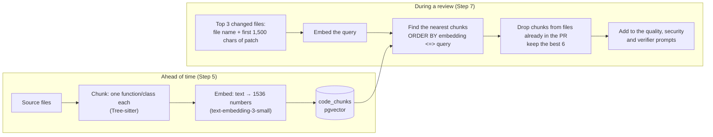

# AI 4: Embeddings and RAG

⬅ [Structured output](03-structured-output.md) · Next ➡ [Context engineering](05-context-engineering.md)

> **In plain words:** RAG (Retrieval-Augmented Generation) means **search first, then ask**. Before the model reviews a change, we search the repo for code related to it and put that code in the prompt. *Embeddings* are what make "related" searchable.

---

## 1. How it begins

RAG has two halves that run at different times:

## 2. What is important

**Embeddings, simply.** An embedding model turns text into a list of numbers (a *vector*) so that text with similar meaning gets similar numbers. You can picture each chunk as a point on a map: `verifyJWT()` and `signToken()` land close together; `formatDate()` lands far away.

**Cosine similarity** measures how close two vectors point in the same direction. pgvector's `<=>` operator returns the cosine *distance*; similarity = 1 − distance.

**Chunking matters most.** Search can only return what you stored.
- Too big → a "blurry" vector and wasted prompt space.
- Too small, or cut mid-function → meaningless pieces.
- CodeGuard chunks by **syntax** (one whole function or class), and falls back to line-based chunks for unsupported languages.

**Key facts:**
- One query **per changed file** (top 3), so one big file can't crowd out the others.
- Chunks from files already in the PR are dropped: the model already sees those.
- Only the **default branch** is indexed, so context is merged, reviewed code.
- RAG is **optional**: no index, or embeddings down → the review runs without it.
- Vectors from two different embedding models can't be compared. Changing the model means re-embedding everything.

## 3. Why we use this

A diff hides context. If a PR changes `token.ts`, the reviewer should also see `verifyJWT.ts`, which trusts it. We can't send the whole repo (too big, too slow, too expensive), so we send the **few pieces most likely to matter**. That's what lets a review say "`verifyJWT.ts` trusts this value" instead of generic advice.

| Choice | Why | Alternative not chosen |
|---|---|---|
| RAG | Code changes daily; search always sees the latest index | **Fine-tuning:** teaches style, not facts; goes stale; costly |
| pgvector inside Postgres | One database, joins, filter by repository, cheap at this size | A separate vector DB (worth it at tens of millions of vectors) |
| Vector search alone | Simple first version | **Hybrid search** (vectors + keyword/BM25) would catch exact names like `verifyJWT` better: a good next step |

## Common questions

- **RAG vs import graph: which finds related code?** Both, differently. The [import graph](06-blast-radius.md) finds code that is *connected* (imports, callers). RAG finds code that is *similar* (same idea, no import link). CodeGuard uses both.
- **What if search returns something irrelevant?** It's labelled "context only, not part of the change", and the verifier judges findings only against what the code really shows.

## Code to read

[RAGService.ts](../../apps/workers/src/rag/RAGService.ts) · [EmbeddingService.ts](../../apps/workers/src/ai/EmbeddingService.ts) · [ASTChunker.ts](../../apps/workers/src/analyzers/ASTChunker.ts) · [code-chunks.ts](../../packages/db/schema/code-chunks.ts) · the RAG node in [nodes/prepare.ts](../../apps/workers/src/pipeline/nodes/prepare.ts)
