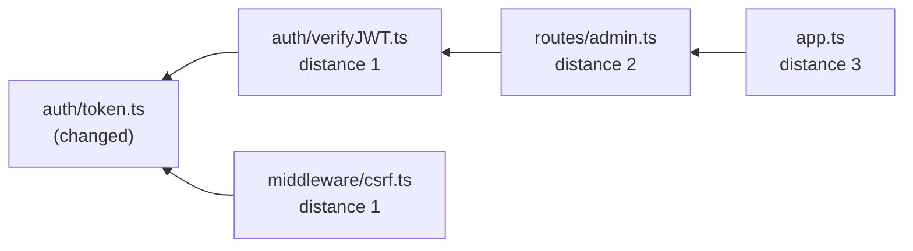

# AI 6: Blast radius

⬅ [Context engineering](05-context-engineering.md) · Next ➡ [The verifier](07-verifier.md)

> **In plain words:** the *blast radius* of a change is every file that could break because of it. A one-line edit to a helper used by 40 files is riskier than 200 new lines in an isolated test. CodeGuard measures this with plain code, **before** any AI call, and tells the AI where to look.

---

## 1. How it begins

In the `build_software_graph` node ([Step 7](../steps/07-prepare-context.md)), using the repo snapshot at the PR's head commit:

1. **Extract imports.** Tree-sitter parses each code file (TS/JS, Python, Go, Java, Rust, C++) and lists what it imports. Aliases like `@/lib/x` and workspace packages are resolved to real files.
2. **Build the graph.** An edge `A → B` means "A imports B". We also store the reverse: "B is imported by A".
3. **Walk backwards from the changed files** with BFS (breadth-first search), up to **3 hops**.

**Output:** every dependent file with its distance, plus "hotspots" (files that many others import).

## 2. What is important

- **BFS, not DFS,** because BFS gives each file its **shortest distance** from the change, and nearer files are riskier.
- **A `visited` set** means circular imports (A → B → A) can't loop forever.
- **Depth limit (3)** stops a change to `utils/index.ts` from "affecting" the whole repo.
- **What it feeds:**
  - **Risk score** (stage 2), together with *criticality* (does it touch `critical_paths` like `billing/**`?).
  - **Ordering** in context packs: hotspots go near the top.
  - **Notes** to the reviewers: "Files that depend on the changed code: …".
  - **Call sites and breaking-change checks** ([page 5](05-context-engineering.md)).
- It's **optional**: if the graph can't be built, the review continues without it.

## 3. Why we use this

The diff tells you **what** changed. The blast radius tells you **how much it matters**. That's the core idea behind CodeGuard. In the demo, a one-line change to `token.ts` makes JWT verification accept unsigned tokens; the graph shows `verifyJWT.ts` and `csrf.ts` depend on it, so the risk is critical, and the reviewer is told exactly which files trust that value.

It's done with code instead of asking the AI because it is **exact, instant, free and repeatable**, and models are bad at reliably tracing imports across many files.

## Known limits

Dynamic imports, dependency injection and reflection don't appear as static imports, so those edges are missed. A language server ("find all references") would be more precise.

## Code to read

[DependencyGraph.ts](../../apps/workers/src/analyzers/DependencyGraph.ts) · [ImportExtractor.ts](../../apps/workers/src/analyzers/ImportExtractor.ts) · [assurance/imports.ts](../../packages/review-engine/src/assurance/imports.ts) · [assurance/risk.ts](../../packages/review-engine/src/assurance/risk.ts) · [DependencyGraph.test.ts](../../apps/workers/src/analyzers/__tests__/DependencyGraph.test.ts)
