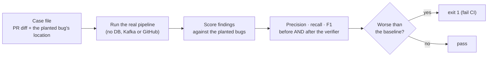

# AI 8: Evals (measuring review quality)

⬅ [The verifier](07-verifier.md) · Next ➡ [Pipeline vs agent](09-pipeline-vs-agent.md)

> **In plain words:** an *eval* is a test suite for AI quality. Without one, "I improved the prompt" is just a feeling. With one, it's a number.

---

## 1. How it begins

Run `pnpm eval`. The harness ([apps/workers/evals](../../apps/workers/evals/README.md)) loads **case files**: small PRs where we already know where the bug is, then runs the **real** review pipeline on each, without a database, Kafka or GitHub.

**13 cases:** SQL injection, XSS, JWT `alg: none`, path traversal, an admin check using `=` instead of `===`, a missing `await`, an async `forEach`, an off-by-one, N+1 queries, two **clean PRs** (to catch false alarms), and two **code-context** cases that can only be solved with other files from the repo.

## 2. What is important

**How each finding is scored:**

| Result | Rule |
|---|---|
| True positive | Right file, and the line is inside the bug's range ± 3 |
| Duplicate | Another report of a bug already found (noise, not a wrong claim) |
| False positive | Anything else; *every* finding on a clean PR |
| Blocking false positive | A false positive at high/critical severity: it could wrongly block a merge |

**The metrics, simply:**

- **Precision:** of what we reported, how much was real? *(High = few wrong comments.)*
- **Recall:** of the real bugs, how many did we find? *(High = few missed bugs.)*
- **F1:** one number that balances the two.

**Scored twice**, before and after the verifier, so the verifier's value is a number, not a claim.

**Honest data:** if any model call fails (e.g. a rate limit), the case is marked **DEGRADED** and left out of the totals. Otherwise a rate limit would look like a missed bug.

**Results** (model `openai/gpt-oss-120b` on Groq):

| Run | Precision before → after verifier | Recall | Lesson |
|---|---|---|---|
| First run | 50% → 57% | 89% | Most false positives came from the **alignment** step repeating real bugs as vague comments |
| After fixing alignment + dedupe | **47% → 80%** | **100%** | False positives per PR 0.55 → 0.22; zero blocking false positives |
| Code-context cases | 67% → 67% | **100%** | The reviewer quoted facts only the new context shows |

## 3. Why we use this

- **Prompts and models change often.** An eval tells you whether a change helped or hurt, before users see it.
- **It finds problems you didn't know about.** The first run showed that one step, not the reviewers, caused most false alarms.
- **For a review bot, precision matters most**, and you can't improve what you don't measure.

## Known limits

- **Small, hand-written set** (13 cases). It shows direction, not a production accuracy figure. Next: cases mined from real bug-fix commits (the commit *before* a fix contains the bug).
- **One model measured.** The same eval can compare providers: `LLM_PROVIDER=anthropic pnpm eval`.
- **No production signal yet**, such as how often developers dismiss a comment.

## Code to read

[evals/README.md](../../apps/workers/evals/README.md) · [evals/cases](../../apps/workers/evals/cases) · [harness.ts](../../apps/workers/src/evals/harness.ts) · [scoring.ts](../../apps/workers/src/evals/scoring.ts) · [run.ts](../../apps/workers/src/evals/run.ts)
