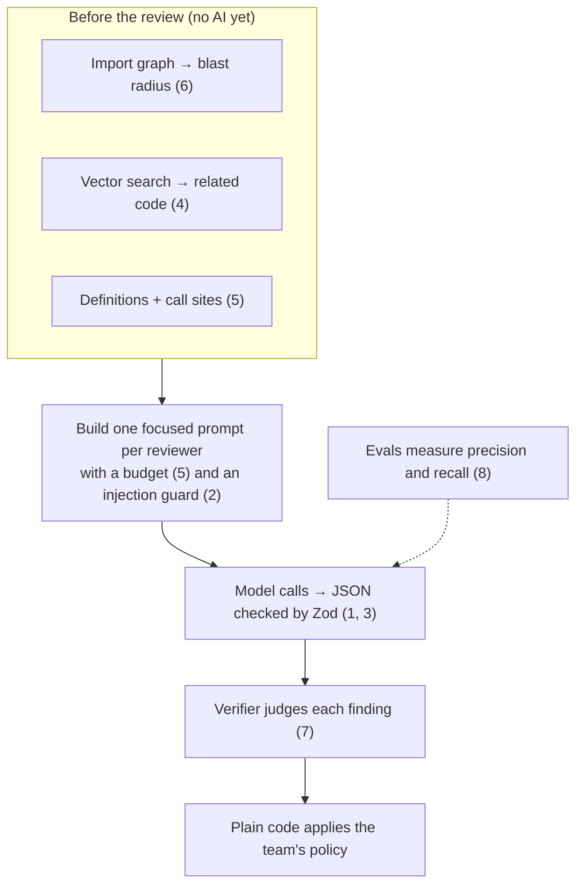

# The AI in CodeGuard, one idea per page

⬅ Back to the [HLD](../HLD.md)

Each page explains **one** AI idea in plain words and follows the same shape:

1. **How it begins:** where this idea shows up in CodeGuard, and what triggers it.
2. **What is important:** the few things you must understand.
3. **Why we use this:** the problem it solves, and what we chose not to do.

Read them in order; each builds on the one before.

| # | Topic | The question it answers |
|---|---|---|
| 1 | [LLM basics](01-llm-basics.md) | What is a model call, a token, a context window, temperature? |
| 2 | [Prompts and prompt injection](02-prompts-and-injection.md) | How do we instruct the model, and stop PR text from hijacking it? |
| 3 | [Structured output](03-structured-output.md) | How do we get reliable JSON instead of chatty text? |
| 4 | [Embeddings and RAG](04-embeddings-and-rag.md) | How does the model "see" related code from the repo? |
| 5 | [Context engineering](05-context-engineering.md) | What exactly goes into each prompt, and why? |
| 6 | [Blast radius](06-blast-radius.md) | How do we know which files a change can break? |
| 7 | [The verifier (LLM-as-a-judge)](07-verifier.md) | How do we cut wrong findings? |
| 8 | [Evals](08-evals.md) | How do we *measure* that the review is good? |
| 9 | [Pipeline vs agent](09-pipeline-vs-agent.md) | Why a fixed pipeline and not an autonomous agent? |

## The whole AI flow on one screen

## How many model calls does one review make?

At most six, and some are skipped when not needed:

| Call | Job | When |
|---|---|---|
| Intent | Why does this PR exist? (title, description, linked issues) | If there's a description |
| Alignment | Does the diff do what the PR says? | If there's an intent |
| Quality reviewer | Bugs, logic, performance, maintainability | Always |
| Security reviewer | Exploitable vulnerabilities, with an attack path | Always (plus the non-AI scanner) |
| Testing reviewer | Are the changed behaviours tested well? | Only if tests changed |
| Verifier | Confirm, downgrade or reject each finding (up to 25) | If there are findings to check |

Embeddings (for search) are a separate, much cheaper kind of call. See [page 4](04-embeddings-and-rag.md).
