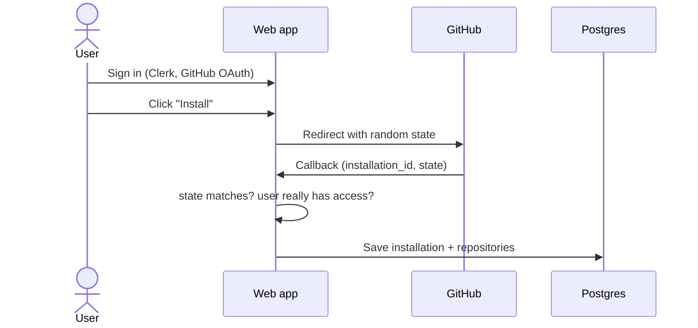

# Step 1: Connect a repo

> **In one line:** the user signs in with Clerk, installs the CodeGuard GitHub App on some repositories, and CodeGuard links that installation to the user.

⬅ [HLD](../HLD.md) · Next ➡ [Step 2: Receive the webhook](02-receive-webhook.md)

---

## 1. How this step begins

Everything starts on the website, before any pull request exists.

1. The user clicks **Sign in** → Clerk logs them in with their GitHub account.
2. The user clicks **Install** → the web app redirects to GitHub with a random **CSRF `state`** value.
3. On GitHub, the user picks which repositories CodeGuard may access.
4. GitHub redirects back to `/api/github/app/callback` with an `installation_id`.
5. The web app checks the request, saves the installation and its repositories, and marks this user as the owner.
6. GitHub also sends an `installation` webhook, which keeps the repo list in sync later.

**Output of this step:** rows in `github_installations` and `repositories`. From now on, GitHub sends CodeGuard a webhook whenever something happens in those repos.

## 2. What is important

- **Two identities, kept separate.**
  - **Clerk** answers *"who is this person on our website?"*
  - **The GitHub App** answers *"what is CodeGuard allowed to do, and on which repos?"*
- **Least privilege.** The App asks only for: read code, write PR comments, write checks. Nothing else.
- **Short-lived tokens.** Workers sign a JWT with the App's private key and exchange it for an **installation token** that expires after about an hour ([octokit.ts](../../apps/workers/src/github/octokit.ts)).
- **The callback is verified twice.** Anyone could forge the callback URL with someone else's `installation_id`. So the server checks that:
  1. the `state` matches the one it generated (CSRF protection), **and**
  2. GitHub confirms the signed-in user really has access to that installation.
- **Per-repo switch.** Each repository has `auto_review_enabled`, so a user can turn automatic reviews on or off from the Install page.

## 3. Why we use this

| Choice | Why | Rejected alternative |
|---|---|---|
| GitHub App | Fine-grained permissions, works when the user is offline, tokens expire fast | A personal access token: too much power, never expires, tied to one person |
| Clerk for login | Ready-made, secure sign-in; we don't store passwords | Building our own auth |
| Verify `state` + access | Stops an attacker linking someone else's installation to their account | Trusting the `installation_id` in the URL |

## What can go wrong

| Situation | What happens |
|---|---|
| Forged callback URL | `state` or access check fails → nothing is linked |
| User removes some repos from the App | `installation_repositories` webhook marks them `inactive`; reviews stop |
| User uninstalls the App | Installation is removed; tokens stop working anyway |

## Code to read

- Routes: [install/route.ts](../../apps/web/src/app/api/github/app/install/route.ts), [callback/route.ts](../../apps/web/src/app/api/github/app/callback/route.ts)
- Logic: [GitHubAppService.ts](../../apps/web/src/services/GitHubAppService.ts), [claim-installations.ts](../../apps/web/src/lib/claim-installations.ts)
- Tables: [github-installations.ts](../../packages/db/schema/github-installations.ts), [repositories.ts](../../packages/db/schema/repositories.ts)
