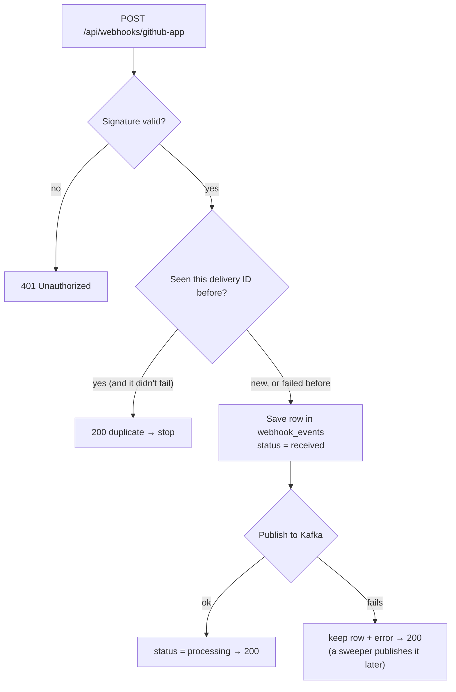

# Step 2: Receive the webhook

> **In one line:** check the signature, drop duplicates, **save the event to Postgres first**, then publish it to Kafka, and always answer GitHub fast.

⬅ [Step 1](01-connect-repo.md) · Next ➡ [Step 3: Kafka](03-kafka.md)

---

## 1. How this step begins

A developer opens or updates a PR. GitHub sends an HTTP `POST` (a **webhook**) to `/api/webhooks/github-app`. The handler does four small things and returns:

**Output of this step:** one row in `webhook_events` and (usually) one message on the Kafka topic `codeguard.webhook.received`.

## 2. What is important

- **Signature check (HMAC-SHA256).** GitHub signs each request with a shared secret. We compute the same hash over the **raw body** and compare it with the `X-Hub-Signature-256` header.
  - Raw body, not parsed JSON, because re-serialising JSON changes the bytes and breaks the hash.
  - Compared with `timingSafeEqual`, so an attacker can't guess the signature byte by byte from response times.
  - No secret configured → reject. It **fails closed**.
- **De-duplication.** Every delivery has a unique `X-GitHub-Delivery` ID, stored in a `UNIQUE` column. A repeat insert does nothing, so we reply "duplicate". Exception: if the earlier attempt **failed**, a redelivery is allowed to run again.
- **Save first (the outbox pattern).** The row is written *before* publishing. If Kafka is down, the row waits as `received` and the **outbox sweeper** ([Step 13](13-recovery.md)) publishes it later.
- **Message key = `owner/repo#number`**, so all events for one PR stay in order in Kafka ([Step 3](03-kafka.md)).
- **Optional: web never touches Kafka.** With `KAFKA_PUBLISH_FROM_WEB=false`, the web app only writes to Postgres and the workers publish. Useful when Vercel can't reach the broker.
- There is also a legacy `/api/webhooks/github` route for old repo webhooks. It runs the exact same handler.

## 3. Why we use this

- **GitHub expects an answer within 10 seconds**, but an AI review takes minutes. So the handler never does the review; it only hands it off.
- **GitHub doesn't retry failed deliveries automatically.** If we drop one, it's gone. That's why we save before doing anything risky.
- **Anyone can POST to our URL.** The signature proves it really came from GitHub.

> **The outbox idea in one breath:** Postgres and Kafka are two separate systems, and we can't write to both at once. So Postgres is the source of truth: write there first, and let a sweeper fix any missed publish. The cost is a possible duplicate message, which every consumer handles. The gain is that **no webhook is ever lost**.

## What can go wrong

| Situation | What happens |
|---|---|
| Kafka is down | GitHub still gets 200; the row waits; the sweeper publishes it later |
| Same delivery sent twice | The UNIQUE delivery ID drops the second one |
| Bad or missing signature | 401 |
| Database is down | 500, so GitHub shows a failed delivery and the user can redeliver; we never publish without saving |
| Web app crashes between save and publish | The row is older than 60 s with no error; the sweeper picks it up |

## Code to read

- [github-webhook.ts](../../apps/web/src/lib/github-webhook.ts): the shared handler
- [webhook-signature.ts](../../apps/web/src/lib/webhook-signature.ts): HMAC check
- [webhook-events.ts](../../packages/db/schema/webhook-events.ts): the outbox table
- Tests: [github-webhook.test.ts](../../apps/web/src/lib/__tests__/github-webhook.test.ts), [webhook-signature.test.ts](../../apps/web/src/lib/__tests__/webhook-signature.test.ts)
