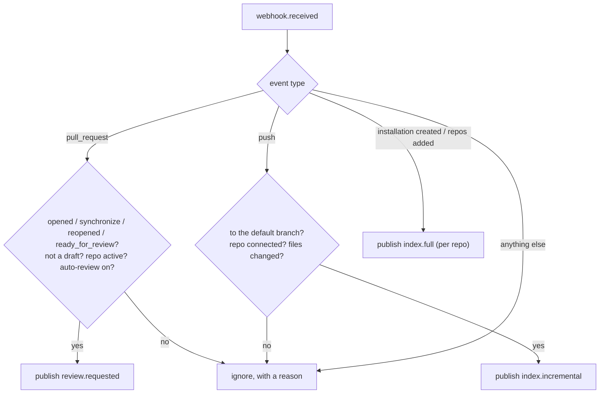

# Step 4: Route the event

> **In one line:** the `webhookProcessor` reads each raw GitHub event and decides what it means: **review a PR**, **re-index changed code**, **index a whole repo**, or **ignore it**.

⬅ [Step 3](03-kafka.md) · Next ➡ [Step 5: Index the code](05-index-code.md)

---

## 1. How this step begins

A message arrives on `codeguard.webhook.received`. The worker passes it to one small function, `decideRoute`, which returns one of four outcomes.

Afterwards, the webhook row is marked `processed`, `ignored` or `failed`.

## 2. What is important

- **`decideRoute` is a pure function.** The database lookup is passed in as a parameter, so every branch is unit-tested without a database.
- **Only real review triggers count.** Labels, comments and closed PRs are noise. Drafts are skipped until they become "ready for review".
- **Only default-branch pushes feed the index.** Unmerged feature-branch code must not show up as "context" in other people's reviews.
- **For a new commit on an open PR** (`synchronize`), the event carries the previous head SHA, so the review can show only the new changes (an *incremental review*).
- **Broken payloads go to the DLQ**, not into a retry loop: missing basic fields → `PermanentError`.

## 3. Why we use this

GitHub sends many kinds of events. Putting the "what does this mean?" decision in one small, tested function keeps the review worker focused on reviewing, and makes the rules easy to read and change.

## What can go wrong

| Situation | What happens |
|---|---|
| Draft PR | Ignored; reviewed later on `ready_for_review` |
| Repo not connected or auto-review off | Ignored; the reason is saved on the row |
| Push that deletes a branch, or changes no files | Ignored |
| Database lookup fails | Normal error → retried by the consumer wrapper, then DLQ |

## Code to read

- [webhookProcessor.ts](../../apps/workers/src/jobs/webhookProcessor.ts) and its [test](../../apps/workers/src/jobs/__tests__/webhookProcessor.test.ts)
