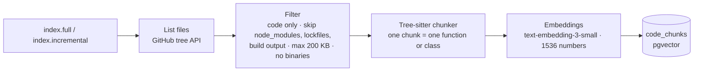

# Step 5: Index the code for search

> **In one line:** read every source file on the default branch, split it into whole functions and classes with Tree-sitter, turn each piece into a vector (an *embedding*), and store it in Postgres with pgvector, so a review can later find related code.

⬅ [Step 4](04-route-event.md) · Next ➡ [Step 6: Claim the review](06-claim-review.md)

> The AI idea behind this step is explained in [ai/04-embeddings-and-rag.md](../ai/04-embeddings-and-rag.md).

---

## 1. How this step begins

Two triggers:

- **`index.full`**: when the App is installed on a repo (or a reviewed repo has no index yet), the `fullIndexer` indexes everything.
- **`index.incremental`**: on every push to the default branch, the `incrementalIndexer` re-indexes only the changed files and removes deleted ones.

**Output of this step:** rows in `code_chunks` with `file_path`, `start_line`, `end_line`, `content` and an `embedding vector(1536)`.

## 2. What is important

- **AST chunking.** Tree-sitter parses code into a syntax tree, so each chunk is a *whole* function or class. If parsing fails or the language isn't supported, it falls back to line-based chunks.
- **The file path is part of the text that gets embedded** (`// File: <path>` + code), so the path carries meaning too.
- **Batches:** files are fetched 10 at a time (GitHub rate limits); embeddings are sent in batches of 100.
- **Re-indexing a file is idempotent:** delete its old chunks, insert new ones.
- **RAG is optional.** If embeddings are down, reviews still run, just with less context.

## 3. Why we use this

A diff alone hides context. If a PR changes `token.ts`, a good reviewer also looks at `verifyJWT.ts`, which uses it. We can't send the whole repo to the AI (too big, too expensive), so we index it once and **search** it during each review.

| Choice | Why | Rejected alternative |
|---|---|---|
| Whole-function chunks | Half a function is a bad search result | Fixed 500-character chunks |
| pgvector in Postgres | One database, joins, easy filter by repository | A separate vector database (Pinecone, Qdrant) |
| Index only the default branch | Context should be merged, reviewed code | Indexing every branch |

## What can go wrong

| Situation | What happens |
|---|---|
| Repo never indexed | Review runs on the diff only; a full index is requested for next time |
| Embedding API down | The indexing job retries, then DLQ; reviews still work without RAG |
| Huge or generated files | Skipped by size and path rules |

## Code to read

- [fullIndexer.ts](../../apps/workers/src/jobs/fullIndexer.ts), [incrementalIndexer.ts](../../apps/workers/src/jobs/incrementalIndexer.ts)
- [RAGService.ts](../../apps/workers/src/rag/RAGService.ts), [EmbeddingService.ts](../../apps/workers/src/ai/EmbeddingService.ts)
- [ASTChunker.ts](../../apps/workers/src/analyzers/ASTChunker.ts), [CodeChunker.ts](../../apps/workers/src/analyzers/CodeChunker.ts)
- Table: [code-chunks.ts](../../packages/db/schema/code-chunks.ts)
