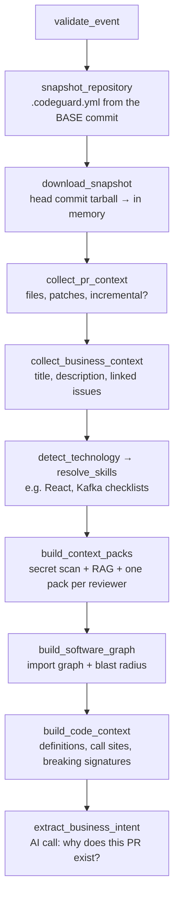

# Step 7: Prepare the context

> **In one line:** before asking any AI model, collect what a careful human reviewer would look at: the team's rules, the PR, the tech stack, the files that depend on the change, related code, and the callers of changed functions, then fit the most important parts into a limited budget.

⬅ [Step 6](06-claim-review.md) · Next ➡ [Step 8: The staged AI review](08-staged-review.md)

> The AI ideas behind this step: [context engineering](../ai/05-context-engineering.md), [RAG](../ai/04-embeddings-and-rag.md), [blast radius](../ai/06-blast-radius.md).

---

## 1. How this step begins

Right after the claim succeeds, the pipeline runs its **prepare** nodes in order:

**Output of this step:** a filled-in `ReviewRunState` object ([state.ts](../../apps/workers/src/pipeline/state.ts)) that every later node reads.

## 2. What is important

- **Config comes from the base commit, never the PR.** Otherwise a PR could add `fail_on: never` to its own `.codeguard.yml` and approve itself. Invalid config falls back to defaults with a warning.
- **Ignore list.** Lockfiles, `dist/`, minified files, source maps and snapshots never reach the model, plus the repo's own `ignore` globs.
- **Read-only snapshot.** One request downloads the head commit as a tarball and unpacks it **in memory** (no disk, nothing executed). It skips `node_modules`, binaries and files over 200 KB, and stops at safe limits (100 MB download, 20,000 files, 60 s). If it fails, the review uses the GitHub API instead.
- **Blast radius.** Tree-sitter extracts every import, builds a graph, and walks it *backwards* from the changed files (up to 3 hops) to find everything that could break. Details: [ai/06-blast-radius.md](../ai/06-blast-radius.md).
- **RAG.** For the top 3 changed source files, search pgvector for similar code, drop chunks from files already in the PR, keep the best 6.
- **Code context.** For identifiers the new code uses, show their **definitions** (with doc comments). For functions the PR changes, show their **call sites** in files the PR did *not* touch. If a signature changed and an outside caller still uses the old shape, that's a **breaking-change** finding.
- **Context packs.** Each reviewer gets its own slice of the diff, ordered by what matters to *it*, within its own budget (in characters): security sees auth and route code first, testing sees tests next to the code they cover.

  | Pack | Budget |
  |---|---|
  | align | 16,000 |
  | quality | 28,000 |
  | security | 24,000 |
  | testing | 16,000 |
  | verify | 28,000 |

  Files are added as **whole patches**, most important first, until the budget is full. The model is told what was left out.
- **Every node here is optional.** If RAG, the graph or the snapshot fails, the review continues with less context and a note in the trace.

## 3. Why we use this

The quality of an AI review depends mostly on **what you put in the prompt**, not on the model. A diff alone hides the real risk: it doesn't show who calls the changed function or what a helper's doc comment promises. And models have a limited context window, where every token costs money and time. So we collect *targeted* context and spend the budget on the riskiest parts.

## What can go wrong

| Situation | What happens |
|---|---|
| Repo never indexed | No RAG chunks; the review runs on the diff + graph; an index is requested |
| Circular imports | The graph walk keeps a `visited` set, so it never loops |
| PR with 300 files | Ranking + budgets pick the riskiest; the rest are listed as omitted |
| Invalid `.codeguard.yml` | Defaults + a visible warning |
| Dynamic imports or path aliases the parser can't see | Those edges are missed (a known limit) |

## Code to read

- [nodes/prepare.ts](../../apps/workers/src/pipeline/nodes/prepare.ts), [nodes/code-context.ts](../../apps/workers/src/pipeline/nodes/code-context.ts), [snapshot.ts](../../apps/workers/src/pipeline/snapshot.ts)
- [assurance/context.ts](../../packages/review-engine/src/assurance/context.ts) (packs and budgets), [diff.ts](../../packages/review-engine/src/diff.ts) (budgeted diff)
- [assurance/code-context.ts](../../packages/review-engine/src/assurance/code-context.ts), [DependencyGraph.ts](../../apps/workers/src/analyzers/DependencyGraph.ts)
- [repo-config.ts](../../packages/review-engine/src/repo-config.ts) (`.codeguard.yml`)
