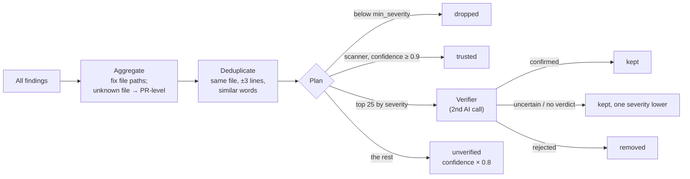

# Step 9: Merge and verify findings

> **In one line:** combine the findings from all reviewers, remove duplicates, and let a **second, independent AI call** confirm, downgrade or reject each one before anything is posted.

⬅ [Step 8](08-staged-review.md) · Next ➡ [Step 10: Score, policy and the decision](10-decide.md)

> The AI idea behind this step: [the verifier (LLM-as-a-judge)](../ai/07-verifier.md).

---

## 1. How this step begins

After stage 3, the pipeline has a pile of findings from the scanner and several AI reviewers. Four nodes clean it up:

```
aggregate_findings → deduplicate_findings → verification_planner → independent_verify
```



## 2. What is important

- **Aggregate.** A finding must point at a file that is really in the diff. Paths like `./src/a.ts` are normalised; a unique suffix match is accepted; otherwise it becomes a PR-level comment instead of a wrong inline one.
- **Deduplicate.** Two findings are the same problem when they're in the same file, within 3 lines, and their wording overlaps enough. The kept one has the highest severity, and **agreement between two reviewers raises its confidence**.
- **Plan.** Deterministic scanner hits with high confidence are already trustworthy and skip the AI check. Up to **25** others, most severe first, go to the verifier (a cost cap).
- **Verify.** The verifier sees the same diff, the related code and the numbered findings, and returns `{ id, verdict, reason }` for each:
  - `confirmed` → kept (confidence at least 0.9)
  - `uncertain`, or **no verdict at all** → kept but **one severity lower**
  - `rejected` → removed (the reason is saved)
- **Only confirmed findings can block a merge on their own.**
- **Two safety rules.** Silence isn't evidence, so a skipped finding counts as uncertain, not rejected. And if the verifier call fails, findings are kept as "unverified" rather than throwing the review away.

## 3. Why we use this

The biggest risk for a review bot isn't missing a bug; it's **false positives**. After a few wrong comments, developers stop reading the bot. A reviewer told to "be thorough" over-reports, so a separate, strict checker raises **precision**. The eval harness measured this: the verifier raised precision from 47% to 80% with no loss of recall (see [ai/08-evals.md](../ai/08-evals.md)).

## What can go wrong

| Situation | What happens |
|---|---|
| Verifier skips a finding | Treated as uncertain: kept, one severity lower |
| Verifier call fails | Findings kept as unverified; the review still completes |
| 200 findings | Only the top 25 are verified; the rest are down-weighted |
| Same model checks itself and agrees too easily | A real risk; mitigated by a different, strict prompt (a different model family would be better) |

## Code to read

- [assurance/findings.ts](../../packages/review-engine/src/assurance/findings.ts) (aggregate, dedupe, plan, apply verdicts)
- [verify.ts](../../packages/review-engine/src/verify.ts) (the verifier prompt and schema)
- [nodes/findings.ts](../../apps/workers/src/pipeline/nodes/findings.ts), [nodes/finalize.ts](../../apps/workers/src/pipeline/nodes/finalize.ts)
