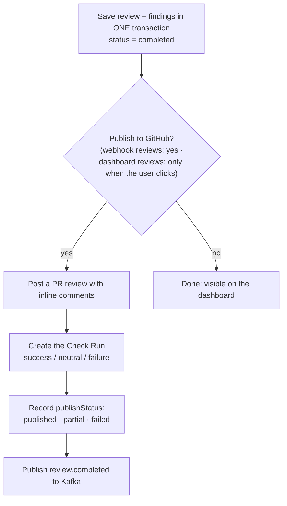

# Step 11: Publish to GitHub

> **In one line:** save the finished review in Postgres **first**, then post inline comments and a Check Run on GitHub, retrying temporary errors and recording what happened.

⬅ [Step 10](10-decide.md) · Next ➡ [Step 12: Dashboard and live progress](12-dashboard.md)

---

## 1. How this step begins

The last two nodes are `generate_insights` (a short summary of what to look at) and `publish_report`:

## 2. What is important

- **Save before posting.** The completed review is stored in one database transaction *before* any GitHub call. Running the save twice gives the same result (idempotent).
- **Inline comments only on real diff lines.** GitHub only accepts comments on lines that appear in the diff; anything else goes into the summary comment.
- **Retries.** GitHub calls are retried with backoff on network errors, 5xx responses and rate limits.
- **Honest status.** The outcome is saved as `published`, `partial` (comments posted, Check Run not) or `failed`, and logged as an error when not fully published.
- **No double posting.** If something throws *after* publishing, the review is not marked failed, so a Kafka retry doesn't post the comments again.
- **No pings.** `@mentions` in model output are neutralised, so the bot can't notify random people.
- **Dashboard reviews** are not posted automatically. The user can post findings from the review page (`/api/github/comment`).

## 3. Why we use this

The AI work is the expensive part. If we posted to GitHub first and the save failed, a retry would re-run the whole AI pipeline **and** post duplicate comments. Saving first means a GitHub hiccup never costs us the review.

## What can go wrong

| Situation | What happens |
|---|---|
| GitHub is down | Retries, then `publishStatus = failed`; the review is still on the dashboard |
| Comments posted but the Check Run failed | `partial` |
| A newer commit was pushed meanwhile | Comments land on the older commit (GitHub marks them outdated) |

## Code to read

- [nodes/finalize.ts](../../apps/workers/src/pipeline/nodes/finalize.ts) (`publish_report`), [store.ts](../../apps/workers/src/pipeline/store.ts) (`saveCompletedReview`)
- [github.ts](../../packages/review-engine/src/github.ts) (inline comments, summary, Check Run)
- [retry.ts](../../apps/workers/src/lib/retry.ts)
