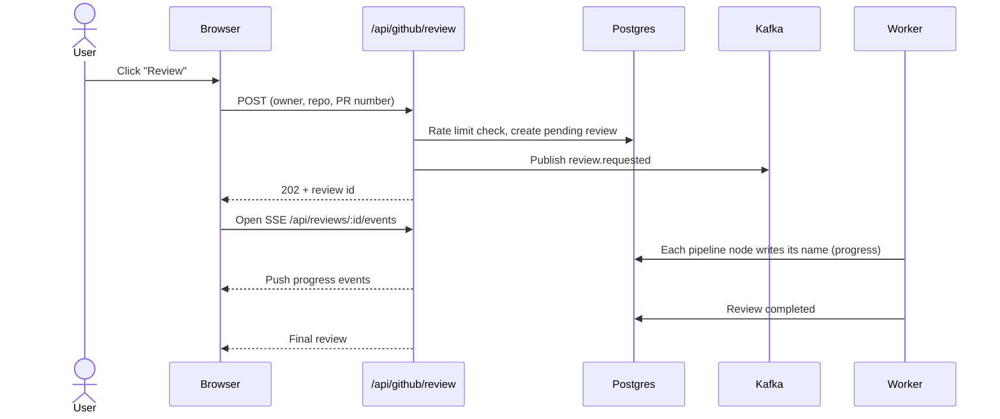

# Step 12: Dashboard and live progress

> **In one line:** a Next.js dashboard lists repos, pull requests and reviews; while a review runs, its progress streams to the browser live with Server-Sent Events (SSE).

⬅ [Step 11](11-publish.md) · Next ➡ [Step 13: Failure and recovery](13-recovery.md)

---

## 1. How this step begins

A signed-in user opens the dashboard. From there they can:

- see their connected repos and open PRs, and click **Review** on any PR,
- open a review and watch it move through the pipeline step by step,
- **resolve** or **dismiss** findings, or post them to GitHub,
- browse past reviews on the **Reports** page.

When the user clicks **Review**:

## 2. What is important

- **Same pipeline as webhooks.** A dashboard review is just a `review.requested` event with `publishToGitHub: false`. There's no second, simpler AI path.
- **One write, two uses.** Each pipeline node writes its name into the review row. That's the **progress** the UI shows *and* the **heartbeat** the recovery sweeper checks ([Step 13](13-recovery.md)).
- **SSE with a polling fallback.** If a proxy blocks SSE, the client polls `/api/reviews/:id` instead ([poll-review.ts](../../apps/web/src/lib/poll-review.ts)).
- **Thin API routes.** Each route is "parse → authenticate → call one service → respond". The logic lives in service classes ([services/](../../apps/web/src/services)), so it's testable without HTTP.
- **Rate limit.** `REVIEW_RATE_LIMIT_PER_HOUR` per user, checked *before* creating a row, so a rejected request costs nothing (429).
- **Idempotent.** Clicking Review twice on the same commit returns the same review.

## 3. Why we use this

| Choice | Why | Rejected alternative |
|---|---|---|
| SSE | Updates only flow server → browser; plain HTTP; auto-reconnect; works on serverless | WebSockets: two-way, need a long-lived server |
| Queue the review, return 202 | The request never waits minutes for the AI | Running the review inside the HTTP request |
| Service layer | Logic is unit-testable and reusable | Logic inside route handlers |

## What can go wrong

| Situation | What happens |
|---|---|
| User closes the tab | The review keeps running; reopening shows the current state |
| SSE drops | The browser reconnects, or falls back to polling |
| User opens someone else's review | Every API checks ownership |
| Kafka unreachable from the web app | The pending row stays; the recovery sweeper publishes it |

## Code to read

- Pages: [app/page.tsx](../../apps/web/src/app/page.tsx), [reviews/[id]/page.tsx](../../apps/web/src/app/reviews/[id]/page.tsx), [install/page.tsx](../../apps/web/src/app/install/page.tsx)
- APIs: [api/github/review](../../apps/web/src/app/api/github/review/route.ts), [api/reviews/[id]/events](../../apps/web/src/app/api/reviews/[id]/events/route.ts), [api/reviews/[id]/findings/[findingId]](../../apps/web/src/app/api/reviews/[id]/findings/[findingId]/route.ts)
- Services: [ReviewService.ts](../../apps/web/src/services/ReviewService.ts), [ReviewPersistenceService.ts](../../apps/web/src/services/ReviewPersistenceService.ts)
