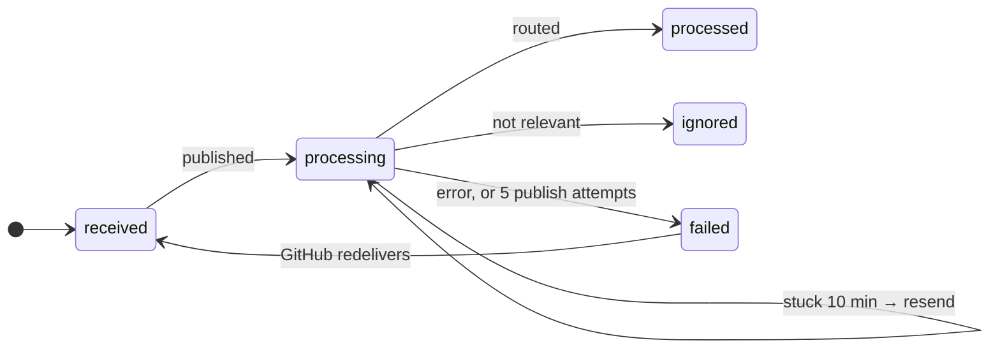
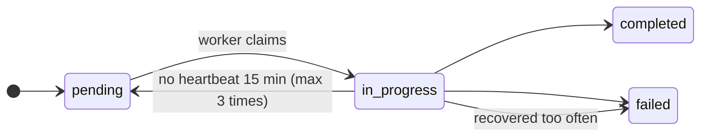

# Step 13: Failure and recovery

> **In one line:** two background jobs, the **outbox sweeper** and the **review recovery sweeper**, read the database every minute and restart anything that got lost or stuck.

⬅ [Step 12](12-dashboard.md) · Back to the [HLD](../HLD.md)

---

## 1. How this step begins

Both sweepers start when the workers start ([index.ts](../../apps/workers/src/index.ts)) and run on a timer (every 60 s by default). They don't wait for a message; they look at the **database**, which is the source of truth.

**Outbox sweeper:** for webhooks that never made it through Kafka.

**Review recovery sweeper:** for reviews whose worker died.

## 2. What is important

**Outbox sweeper** ([webhookOutboxSweeper.ts](../../apps/workers/src/jobs/webhookOutboxSweeper.ts)):
- `received` with an error, or older than 60 s → publish it.
- `processing` but not finished after 10 minutes → resend it.
- After 5 publish attempts → mark `failed` instead of looping forever.
- Only looks at rows from the last 24 hours, 50 at a time.

**Review recovery sweeper** ([reviewRecoverySweeper.ts](../../apps/workers/src/jobs/reviewRecoverySweeper.ts)):
- `in_progress` with no heartbeat for 15 minutes → back to `pending` (at most 3 times), then `failed` with a friendly message so the UI stops spinning.
- `pending` reviews nobody picked up → republish `review.requested`.

**Both are safe to run twice**, because every consumer is idempotent ([Step 6](06-claim-review.md)).

### The failure table

| What breaks | What happens | Why nothing is lost |
|---|---|---|
| Kafka down when the webhook arrives | GitHub gets 200, row waits as `received` | Outbox sweeper |
| Duplicate webhook | Unique delivery ID drops it | Idempotent at the door |
| Duplicate review message | The claim fails | Idempotent consumer |
| Worker crashes mid-review | Stale after 15 min → pending → republished | Recovery sweeper |
| Message lost after publishing | Resent after 10 min | Outbox sweeper |
| Handler keeps failing | 3 attempts → DLQ | The lane isn't blocked |
| AI provider down | Optional steps skipped, retries | A thinner review, not none |
| GitHub post fails | Retries, status recorded | Review was saved first |

## 3. Why we use this

Retries *inside* a process die with the process. A crash, a redeploy or a lost message would leave work stuck forever. A sweeper reads the **database**, so it recovers from all of those. Combined with idempotent consumers, the system gives one simple promise: **work may be repeated, but it is never lost**.

## What can go wrong

| Situation | What happens |
|---|---|
| Two worker replicas both run sweepers | Both may republish the same row; harmless because consumers are idempotent (`FOR UPDATE SKIP LOCKED` would avoid it) |
| A review keeps crashing the worker | After 3 recoveries it's marked failed |

## Code to read

- [webhookOutboxSweeper.ts](../../apps/workers/src/jobs/webhookOutboxSweeper.ts) and its [test](../../apps/workers/src/jobs/__tests__/webhookOutboxSweeper.test.ts)
- [reviewRecoverySweeper.ts](../../apps/workers/src/jobs/reviewRecoverySweeper.ts)
- [store.ts](../../apps/workers/src/pipeline/store.ts) (`STALE_REVIEW_MS`)
